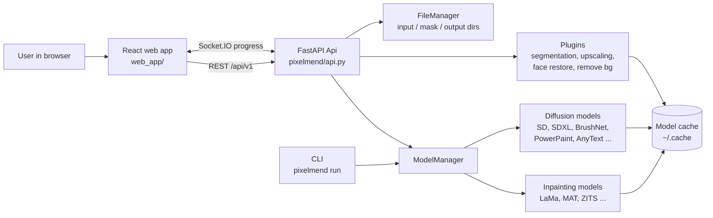

# PixelMend

A self-hosted, browser-based image inpainting tool that erases unwanted objects, repairs old photos and extends images using state-of-the-art AI models.

## What This Project Does

Removing a watermark, a stranger in the background or a scratch on an old photo usually
means hours in a photo editor. PixelMend lets you paint over the area you want gone and
have an AI model fill it in, all on your own machine (CPU, NVIDIA GPU or Apple Silicon).
It is aimed at photographers, designers, dataset curators and anyone who wants a local,
private alternative to online "magic eraser" services.

Main features:

- **Object removal** with fast, dedicated inpainting models: LaMa, Anime-LaMa, MAT, FcF,
  ZITS, MI-GAN, Manga, LDM and OpenCV.
- **Prompt-guided editing** with Stable Diffusion 1.5/2, SDXL, Kandinsky 2.2,
  Paint by Example, InstructPix2Pix, BrushNet, PowerPaint (v1/v2), ControlNet and AnyText
  (text rendering).
- **Outpainting**: extend an image beyond its borders with the Extender tool.
- **High-resolution strategies**: process large images at original size, resized, or
  cropped around the mask.
- **Plugins**: interactive segmentation (Segment Anything / SAM 2 / MobileSAM), background
  removal (RMBG / rembg), anime segmentation, Real-ESRGAN upscaling and GFPGAN /
  RestoreFormer face restoration.
- **File manager**: browse a folder of input images, masks and saved outputs from the UI.
- **Batch processing** from the command line for whole folders of images and masks.
- **Web config page** (Gradio) for building a server configuration file without editing JSON.

## How It Works

PixelMend has two parts: a Python backend (FastAPI + Socket.IO) that loads and runs the
models, and a React single-page app that provides the editor. In production the built
frontend is served by the backend itself, so everything runs from one command.

1. The user opens the web app, loads an image and paints a mask (or generates one with
   a segmentation plugin).
2. The frontend sends the image, the mask and the chosen settings to `POST /api/v1/inpaint`.
3. `Api` (`pixelmend/api.py`) validates the request against the Pydantic schemas in
   `pixelmend/schema.py` and passes it to `ModelManager`.
4. `ModelManager` (`pixelmend/model_manager.py`) holds the active model, switches models
   on request and dispatches to the right implementation in `pixelmend/model/`.
5. The model applies the high-resolution strategy, runs inference with PyTorch / diffusers
   and returns the result. Progress for diffusion models is streamed back over Socket.IO.
6. The backend encodes the image (keeping EXIF / PNG metadata) and the frontend shows it,
   ready for further edits or saving.

Plugins follow the same path through `POST /api/v1/run_plugin_gen_mask` and
`/run_plugin_gen_image`, and the CLI `run` command reuses the same models for batch jobs.



## Project Structure

```
pixelmend/
├── pixelmend/                  # Python package (backend)
│   ├── __init__.py             # Environment setup and the CLI entry point
│   ├── __main__.py             # Allows `python -m pixelmend`
│   ├── cli.py                  # Typer CLI: start, run, download, list, start-web-config
│   ├── api.py                  # FastAPI routes, Socket.IO server and static web app hosting
│   ├── schema.py               # Pydantic request/response models and enums
│   ├── model_manager.py        # Loads, switches and runs the active model
│   ├── download.py             # Model download and local model scanning
│   ├── batch_processing.py     # Folder-to-folder batch inpainting
│   ├── helper.py               # Image loading, encoding, resizing and model download helpers
│   ├── runtime.py              # Environment / dependency info dump
│   ├── web_config.py           # Gradio page for editing the server config file
│   ├── benchmark.py            # Speed and memory benchmark for models
│   ├── const.py                # Model names, defaults and CLI help text
│   ├── installer.py            # Installs optional plugin dependencies
│   ├── file_manager/           # Browsing and thumbnails for input, mask and output folders
│   ├── model/                  # Inpainting and diffusion model implementations
│   │   ├── anytext/            # AnyText text-rendering model
│   │   ├── brushnet/           # BrushNet pipeline and wrapper
│   │   ├── power_paint/        # PowerPaint v1 and v2
│   │   ├── helper/             # ControlNet preprocessors and CPU text encoder
│   │   └── original_sd_configs/# Stable Diffusion YAML configs for single-file models
│   └── plugins/                # Segmentation, background removal, upscaling, face restoration
├── web_app/                    # React + TypeScript frontend (Vite, Tailwind, shadcn/ui)
│   ├── src/components/         # Editor, side panel, file manager, plugins, settings UI
│   ├── src/lib/                # API client, Zustand store, types and constants
│   └── src/hooks/              # Reusable React hooks (hotkeys, images, resolution)
├── main.py                     # Run the CLI from source: `python main.py start ...`
├── setup.py                    # Package metadata and `pixelmend` console script
├── requirements.txt            # Runtime Python dependencies
└── requirements-dev.txt        # Packaging and development dependencies
```

## Tech Stack

| Layer | Technology | Purpose |
|---|---|---|
| Language | Python 3.10 | Backend, models and CLI |
| ML framework | PyTorch ≥ 2.0 | Model inference on CPU, CUDA or Apple MPS |
| Diffusion | diffusers 0.27.2, transformers ≥ 4.39.1, accelerate, peft 0.7.1 | Stable Diffusion, SDXL, BrushNet, PowerPaint, ControlNet pipelines |
| Model hub | huggingface_hub 0.25.2, safetensors | Downloading and loading model weights |
| Image processing | OpenCV, Pillow 9.5.0, piexif 1.1.3, controlnet-aux 0.0.3 | Image I/O, metadata and ControlNet preprocessing |
| Backend API | FastAPI 0.108.0, Uvicorn, python-socketio 5.7.2 | REST API, static hosting and live progress events |
| Validation | Pydantic ≥ 2.5.2 | Request and response schemas |
| CLI | Typer, typer-config 1.4.0, Rich, Loguru | Commands, JSON config files and logging |
| Config UI | Gradio 4.21.0 | Web page for editing the server config |
| Frontend | React 18, TypeScript 5, Vite 5 | Single-page editor |
| UI | Tailwind CSS 3, shadcn/ui (Radix UI) | Components and styling |
| State and data | Zustand 4, TanStack Query 5, Axios, socket.io-client 4 | Client state, API calls and progress updates |

## How to Run This Project

1. **Prerequisites**
   - Python 3.10 (the dependency pins target it)
   - Node.js 18 or newer and npm (to build the web app)
   - Git
   - Optional: an NVIDIA GPU with CUDA, or an Apple Silicon Mac, for faster diffusion models

2. **Clone**

   ```bash
   git clone https://github.com/hadeeddev921/pixelmend.git
   cd pixelmend
   ```

3. **Install dependencies**

   ```bash
   python3 -m venv venv
   source venv/bin/activate          # Windows: venv\Scripts\activate
   pip install torch torchvision     # pick the CUDA / CPU build for your machine from pytorch.org
   pip install -r requirements.txt
   pip install -e .                  # installs the `pixelmend` command
   pixelmend install-plugins-packages  # optional: dependencies for the plugins
   ```

4. **Build the web app** (the server serves it from `pixelmend/web_app/`)

   ```bash
   cd web_app
   npm install
   npm run build
   cp -r dist ../pixelmend/web_app
   cd ..
   ```

5. **Environment variables**: none are required. All settings are CLI flags or a JSON
   config file (`pixelmend start --config config.json`, which `pixelmend start-web-config`
   can generate). These optional variables are read if set:

   | Variable | Description | Example |
   |---|---|---|
   | `XDG_CACHE_HOME` | Base folder for downloaded models (default `~/.cache`) | `/data/cache` |
   | `WEBUI_RICH_EXCEPTIONS` | Print detailed Rich tracebacks for API errors | `1` |
   | `ATTN_PRECISION` | Attention precision used by AnyText | `fp32` |
   | `VITE_BACKEND` | Backend URL for the frontend dev server only (`web_app/.env.local`) | `http://127.0.0.1:8080` |

6. **Database setup**: not needed. Models are downloaded automatically on first use, or
   ahead of time with:

   ```bash
   pixelmend download --model runwayml/stable-diffusion-inpainting
   pixelmend list
   ```

7. **Run**

   ```bash
   pixelmend start --model lama --device cpu --port 8080
   # or without installing: python main.py start --model lama --device cpu --port 8080
   ```

   Open http://127.0.0.1:8080 in your browser. Use `--device cuda` or `--device mps` for
   GPU acceleration, `--input ./images --output-dir ./output` to enable the file manager,
   and flags such as `--enable-interactive-seg` or `--enable-remove-bg` to turn on plugins.

   Batch-process a folder from the command line:

   ```bash
   pixelmend run --model lama --device cpu --image ./images --mask ./masks --output ./output
   ```

   For frontend development, run the backend as above, then:

   ```bash
   cd web_app
   echo "VITE_BACKEND=http://127.0.0.1:8080" > .env.local
   npm run dev
   ```

## License

Licensed under the Apache License 2.0. See [LICENSE](LICENSE).
